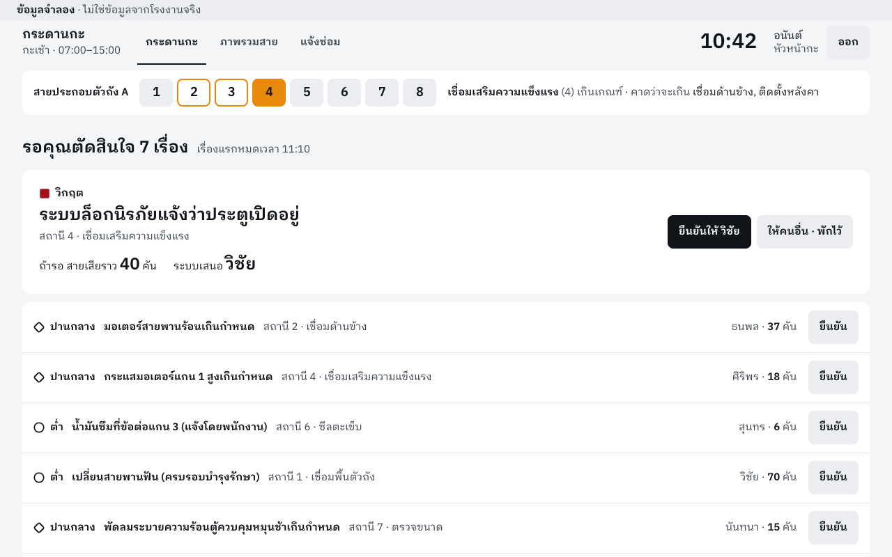
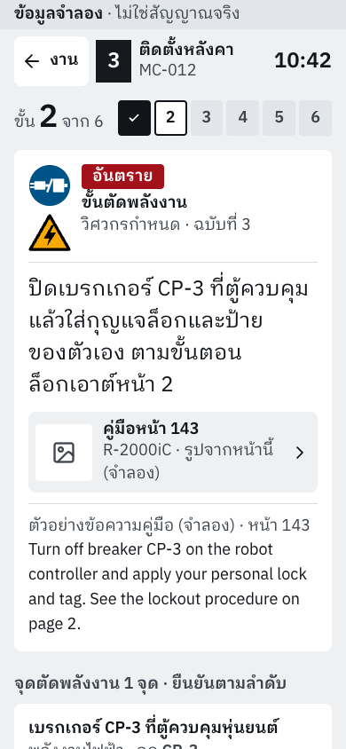

# Predictive maintenance with automatic work-order dispatch

[](https://github.com/fournarin/predictive-maintenance-dispatch/actions/workflows/ci.yml)    

A maintenance system for a vehicle assembly plant moving towards full automation.
It watches machine signals for faults that have happened and for trends heading
towards one, builds a work order whose repair steps come from the machine's manual
with a page citation on every step, ranks the queue against what the shift can
absorb, and hands each placement to a shift lead to release.

Individual Study project at Chulalongkorn University (one student, one term).
**No plant data has been seen** - every figure below is on generated signals and
synthetic and manufacturer manuals; see [limitations](#limitations).

<table>
<tr>
<td width="70%"></td>
<td width="30%"></td>
</tr>
<tr>
<td>Shift lead's board - the critical job first, with what waiting costs and who the round proposes.</td>
<td>Technician's step - isolation marked as danger, cited to the manual page.</td>
</tr>
</table>

<sub>Design-system renders of the second-generation screens, on synthetic data.</sub>

## Highlights

- **Forecasting** - time to a threshold within **5.4 min** (MAE) up to an hour
  ahead, against 13.5 for a two-point baseline, over 21 seeds.
- **Dispatch** - four policies compared over **7,800 simulated shifts** with a
  Holm correction. The headline is mostly negative and stated as such.
- **Repair steps** - drafted from manuals at build time and approved by a person;
  no language model writes instructions while a technician waits
  ([ADR-003](docs/adr/0003-no-llm-generated-repair-text-at-runtime.md)).
- **Engineering** - 139 decision records, 1,763 Python tests, CI gates for
  format, types, import boundaries and real-PostgreSQL tests.

## How it works


Each layer builds and tests on its own; layers 2 and 3 never wait on layer 1.
Four rules shape the rest:

1. **No LLM at run time.** A wrong torque value or lockout order is a risk to a
   person, so the model drafts before the job for an engineer to approve, enforced
   by an import rule and a network boundary
   ([ADR-003](docs/adr/0003-no-llm-generated-repair-text-at-runtime.md),
   [ADR-029](docs/adr/0029-where-the-models-run.md)).
2. **Every step carries its source** - document, page, revision, approver; a
   closed work order keeps a frozen `playbook_snapshot` of what it instructed.
3. **Every ticket explains itself** - why this job, why now, why ranked here
   ([ADR-005](docs/adr/0005-every-ticket-carries-its-reason.md)).
4. **Thin evidence is said out loud** - "not found, see manual page X or ask an
   engineer" beats a guess.

## Results

All produced by scripts in this repository and reproducible from a clean checkout.

| What | Result | Details |
|---|---|---|
| ETA accuracy | MAE 5.4 min within 1 h, 15.2 at 1-3 h (baseline 13.5 / 41.4) | [prediction-baseline](docs/prediction-baseline.md) |
| Dispatch policies | with three technicians all within ~3% of the oracle; with one, CP-SAT loses significantly less than greedy | [results](docs/results/README.md) · [why](docs/results/diagnosis.md) |
| Drafting, held-out set | 12/12 EN, 10/12 TH; unknown symptoms return "not found" | [rag-evaluation](docs/results/rag-evaluation.md) |
| Drafting, five real manuals | 30/54 (56%), 2 unsafe drafts (4%), measured as shipped | [realdocs2](docs/results/realdocs2.md) |
| Machine health ranking | degraded machines ranked first in 39 of 40 draws | [health](docs/results/health.md) |
| End-to-end and accessibility | 7/7 Playwright flows, 0 axe violations on 11 screens | [e2e](docs/results/e2e.md) |
| Second-generation screens | 78% fewer words on the shift lead's board (a UI count, not a usability result) | [before-after](docs/results/before-after.md) |
| Whole system at one commit | every gate green; 1,763 Python + 60 web tests | [final-check](docs/results/final-check.md) |
| Shift lead vs scheduler agreement | no figures yet - needs a trial with a person | [confirmations](docs/results/confirmations.md) |

## Running it

On a machine with Docker and about 10 GB free:

```bash
cp .env.example .env     # then change POSTGRES_PASSWORD
uv run python scripts/rehearse.py --fresh
```

This brings up the stack, seeds it, checks the screens and waits until there is
work to show. Web at `http://localhost:3000`, API at `http://localhost:8000`.
Full guides: [install](docs/install.md) · [demo walkthrough](docs/demo.md).

Development:

```bash
uv sync
uv run pytest -m "not db"                          # no database needed
DATABASE_URL=postgresql://... uv run pytest -m db  # real PostgreSQL
uv run ruff check . && uv run mypy && uv run lint-imports
```

## Limitations

- **No plant data.** `SyntheticSource` generates the demo and warns at boot;
  `ReplaySource` loads a CSV export ([plant-data](plant-data/README.md)); a live
  OPC UA source does not exist.
- **Drafting is not measured on the plant's manuals**, which are under NDA. The
  two-manual figures (9/9, 8/9) came after fixes made on those same questions.
- **The drafter is extractive** - it quotes the best page; the model server is
  deployed but unused.
- **PM history is unknown**, so on day one every PM task is due; real dates load
  with `scripts/import_plant_data.py --pm-history`.
- **The improvement loops only propose.** Duration and threshold changes are shown
  to an engineer and applied by hand
  ([ADR-087](docs/adr/0087-the-improvement-loops-get-a-screen-and-no-write-path.md)).
- **Not yet tried by a technician.** One production-line engineer reviewed the
  first screens, which led to the rebuild; the new screens are 53 of 107
  requirements built ([ADR-014](docs/adr/0014-report-and-technician-trial-are-reserved-unconditionally.md)).
- Backup and restore are documented but never run; a technician's closing note
  reaches no screen.

## Read next

- [`docs/adr/`](docs/adr/README.md) - every design decision, append-only. Start
  with [ADR-003](docs/adr/0003-no-llm-generated-repair-text-at-runtime.md) (no
  LLM at run time), [ADR-020](docs/adr/0020-predictions-from-trend-extrapolation-measured-on-synthetic-data.md)
  (predicting without failure labels) and
  [ADR-011](docs/adr/0011-load-ratio-switches-dispatch-behaviour.md) (gate plus
  score instead of one formula).
- [`docs/design/`](docs/design/README.md) - requirements and reviews behind the
  second-generation screens.

**Stack:** Python, FastAPI, PostgreSQL (plain SQL, job queue as a table), Qdrant +
PostgreSQL full-text fused on ranks, OR-Tools CP-SAT, Next.js, Docker -
on-premise only ([ADR-008](docs/adr/0008-technology-stack.md)).

## Licence

All rights reserved. Public so it can be read and assessed; not open source.
Copying, modifying, redistributing or use in a plant or product needs written
permission - see [LICENSE](LICENSE). A research prototype: nothing it produces
is for use on real equipment.
