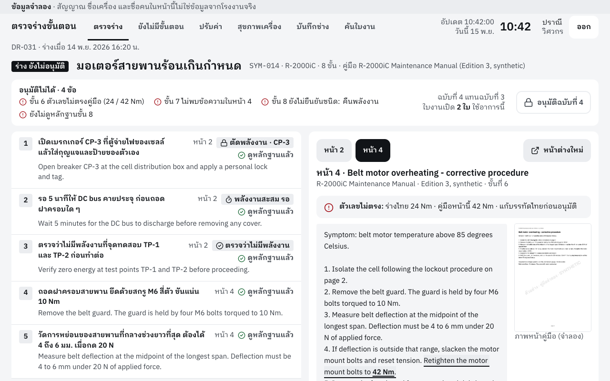
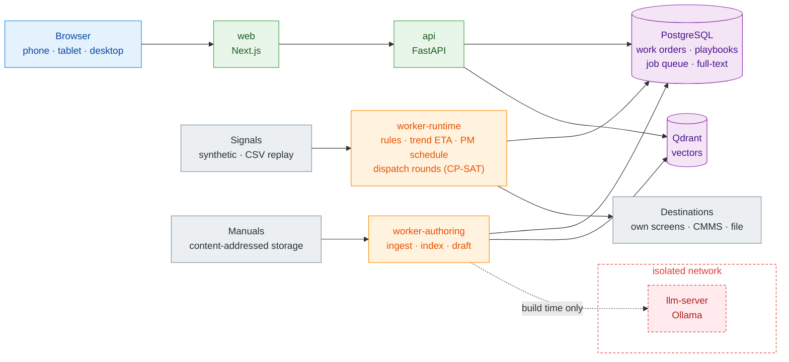

# Predictive maintenance with automatic work-order dispatch

[](https://github.com/fournarin/predictive-maintenance-dispatch/actions/workflows/ci.yml)    

A maintenance system for a vehicle assembly plant moving towards full automation.
It watches machine signals for faults that have happened and for trends heading
towards one, builds a work order whose repair steps come from the machine's manual
with a page citation on every step, ranks the queue against what the shift can
absorb, and hands each placement to a shift lead to release.

Individual Study project at Chulalongkorn University (one student, one term).
**No plant data has been seen** - every figure below is on generated signals and
synthetic and manufacturer manuals; see [limitations](#limitations).

<p align="center">
  <a href="#why">Why</a> · <a href="#quick-start">Quick start</a> · <a href="#screens">Screens</a> · <a href="#architecture">Architecture</a> · <a href="#results">Results</a> · <a href="#documentation">Docs</a>
</p>



<sub>The engineer's review screen - each drafted step checked against the manual page it cites; approval stays locked until every mismatch is resolved. A design render on synthetic data: this screen is designed, not yet built.</sub>

## Why

| Cited, approved steps | Every ticket explains itself | Says when it doesn't know |
|---|---|---|
| Repair steps come from the manual with a page on every step, approved by an engineer. No LLM writes instructions at run time. | Why this job, why now, why ranked here - and the shift lead confirms every placement. | "Not found - see manual page X or ask an engineer" instead of a plausible guess. |

## Highlights

- **Forecasting** - time to a threshold within **5.4 min** (MAE) up to an hour
  ahead, against 13.5 for a two-point baseline, over 21 seeds.
- **Dispatch** - four policies compared over **7,800 simulated shifts** with a
  Holm correction. The headline is mostly negative and stated as such.
- **Repair steps** - drafted from manuals at build time and approved by a person;
  no language model writes instructions while a technician waits
  ([ADR-003](docs/adr/0003-no-llm-generated-repair-text-at-runtime.md)).
- **Engineering** - 139 decision records, 1,763 Python tests, CI gates for
  format, types, import boundaries and real-PostgreSQL tests.

## Quick start

On a machine with Docker and about 10 GB free:

```bash
cp .env.example .env     # then change POSTGRES_PASSWORD
uv run python scripts/rehearse.py --fresh
```

This brings up the stack, seeds it, checks the screens and waits until there is
work to show.

| Service | URL |
|---|---|
| Web | http://localhost:3000 |
| API | http://localhost:8000 (loopback only) |

Full guides: [install](docs/install.md) · [demo walkthrough](docs/demo.md).
Development:

```bash
uv sync
uv run pytest -m "not db"                          # no database needed
DATABASE_URL=postgresql://... uv run pytest -m db  # real PostgreSQL
uv run ruff check . && uv run mypy && uv run lint-imports
```

## Screens

Each role lands on its own work, not on a menu.

| Route | Who | What |
|---|---|---|
| `/work` | technician | My jobs - steps with page citations, isolation points, close, handover, print |
| `/report` | everyone | Report a fault (the only screen an operator has) |
| `/board` | shift lead | Confirm or reassign what the dispatch round proposed, with the reason |
| `/overview` | shift lead, engineer | The line - stations, machine health, what is coming |
| `/review` | engineer | Approve drafted repair steps against the manual, one machine model at a time |
| `/gaps` | engineer | Symptoms that reached a ticket with no approved steps |
| `/loops` | engineer | What closed jobs and false alarms propose - shown, never applied automatically |
| `/notes` | engineer | Technicians' closing notes, by symptom |

## Architecture



<sub>🟦 browser · 🟩 web and API · 🟧 workers · 🟪 data stores · ⬜ data in and out · 🟥 language model, isolated</sub>

Eight Compose services, on-premise only. The **web** app is the only thing a browser reaches;
the **api** listens on loopback. **worker-runtime** turns signals and the PM
schedule into work orders and runs the dispatch rounds; **worker-authoring**
indexes manuals and drafts playbooks for an engineer to approve. Only
worker-authoring can reach the language model, on its own network - that is how
"no LLM at run time" is enforced rather than promised
([ADR-003](docs/adr/0003-no-llm-generated-repair-text-at-runtime.md),
[ADR-029](docs/adr/0029-where-the-models-run.md)). The job queue is a PostgreSQL
table, so a job and its result commit together. The current drafter is
extractive, so `llm-server` is deployed but unused.

**Stack:** Python · FastAPI · PostgreSQL (plain SQL, no ORM) · Qdrant + PostgreSQL
full-text fused on ranks · OR-Tools CP-SAT · Next.js · Docker
([ADR-008](docs/adr/0008-technology-stack.md)).

## Results

All produced by scripts in this repository and reproducible from a clean checkout.

| What | Result | Details |
|---|---|---|
| ETA accuracy | MAE 5.4 min within 1 h, 15.2 at 1-3 h (baseline 13.5 / 41.4) | [prediction-baseline](docs/prediction-baseline.md) |
| Dispatch policies | with three technicians all within ~3% of the oracle; with one, CP-SAT loses significantly less than greedy | [results](docs/results/README.md) · [why](docs/results/diagnosis.md) |
| Drafting, held-out set | 12/12 EN, 10/12 TH; unknown symptoms return "not found" | [rag-evaluation](docs/results/rag-evaluation.md) |
| Drafting, five real manuals | 30/54 (56%), 2 unsafe drafts (4%), measured as shipped | [realdocs2](docs/results/realdocs2.md) |
| Machine health ranking | degraded machines ranked first in 39 of 40 draws | [health](docs/results/health.md) |
| End-to-end and accessibility | 7/7 Playwright flows, 0 axe violations on 11 screens | [e2e](docs/results/e2e.md) |
| Second-generation screens | 78% fewer words on the shift lead's board (a UI count, not a usability result) | [before-after](docs/results/before-after.md) |
| Whole system at one commit | every gate green; 1,763 Python + 60 web tests | [final-check](docs/results/final-check.md) |
| Shift lead vs scheduler agreement | no figures yet - needs a trial with a person | [confirmations](docs/results/confirmations.md) |

## Limitations

- **No plant data.** `SyntheticSource` generates the demo and warns at boot;
  `ReplaySource` loads a CSV export ([plant-data](plant-data/README.md)); a live
  OPC UA source does not exist.
- **Drafting is not measured on the plant's manuals**, which are under NDA. The
  two-manual figures (9/9, 8/9) came after fixes made on those same questions.
- **The drafter is extractive** - it quotes the best page; the model server is
  deployed but unused.
- **PM history is unknown**, so on day one every PM task is due; real dates load
  with `scripts/import_plant_data.py --pm-history`.
- **The improvement loops only propose.** Duration and threshold changes are shown
  to an engineer and applied by hand
  ([ADR-087](docs/adr/0087-the-improvement-loops-get-a-screen-and-no-write-path.md)).
- **Not yet tried by a technician.** One production-line engineer reviewed the
  first screens, which led to the rebuild; the new screens are 53 of 107
  requirements built ([ADR-014](docs/adr/0014-report-and-technician-trial-are-reserved-unconditionally.md)).
- Backup and restore are documented but never run.

## Repository layout

```
src/pdm/contracts/       data contracts as types (imports nothing else)
src/pdm/signals/ triggers/   layer 1: signal sources, rules, trend prediction
src/pdm/retrieval/ authoring/ llm/   build-time RAG and drafting
src/pdm/playbooks/ work/ layer 2: approved playbooks, work orders, closing
src/pdm/dispatch/        layer 3: load gate, score, CP-SAT, proposals
src/pdm/sinks/           layer 4: own screens, CMMS adapter, file
src/pdm/sim/ baselines/  discrete-event simulator and policy comparison
src/pdm/api/ workers/    FastAPI app, worker-runtime, worker-authoring
web/                     Next.js screens
config/                  plant.yaml, policy.yaml, rules.yaml
fixtures/corpus/         synthetic manuals with their own answer key
docs/adr/                decision records, append-only
```

## Documentation

| Document | Purpose |
|---|---|
| [docs/install.md](docs/install.md) | Installation, configuration, backup |
| [docs/demo.md](docs/demo.md) | What to click, in what order, as whom |
| [docs/contracts.md](docs/contracts.md) | `Signal`, `Finding`, `Playbook`, `WorkOrder` and the resource contracts |
| [docs/invariants.md](docs/invariants.md) | The fifteen invariants the principles turn into |
| [docs/results/](docs/results/README.md) | Every measurement, with the script that produced it |
| [docs/adr/](docs/adr/README.md) | 139 design decisions - start with ADR-003, [ADR-011](docs/adr/0011-load-ratio-switches-dispatch-behaviour.md), [ADR-020](docs/adr/0020-predictions-from-trend-extrapolation-measured-on-synthetic-data.md) |
| [docs/design/](docs/design/README.md) | Requirements and review rounds behind the second-generation screens |
| [docs/trial-protocol.md](docs/trial-protocol.md) | How a technician trial is run |

## Licence

All rights reserved. Public so it can be read and assessed; not open source.
Copying, modifying, redistributing or use in a plant or product needs written
permission - see [LICENSE](LICENSE). A research prototype: nothing it produces
is for use on real equipment.
