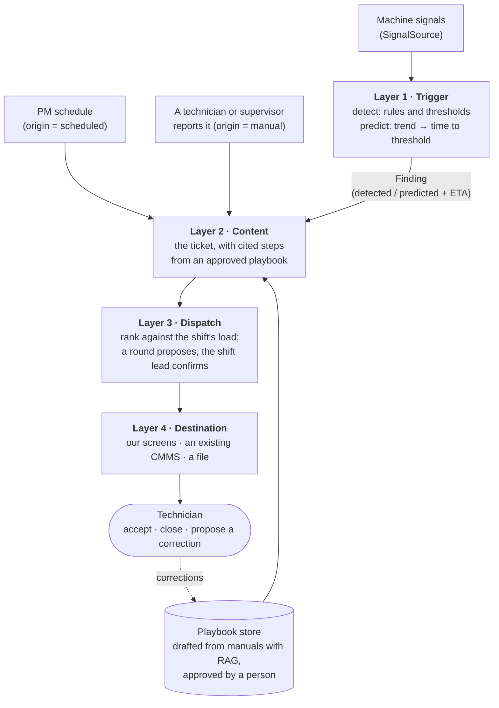

# Predictive maintenance with automatic work-order dispatch

[](https://github.com/fournarin/predictive-maintenance-dispatch/actions/workflows/ci.yml)    

A maintenance system for a vehicle assembly plant moving towards full
automation. It watches machine signals for faults that have happened and for
trends heading towards one, assembles a work order carrying the repair steps from
the machine's manual with a page citation on every step, ranks the queue against
what the shift can actually absorb, and hands each placement to a shift lead to
release. Built as an Individual Study project: one student, one term.

**At a glance**, all on generated data (details and caveats below):

- **Forecasting** - time to a threshold within 5.4 minutes (MAE) up to an hour
  ahead, against 13.5 for a two-point baseline, over 21 seeds
  ([prediction baseline](docs/prediction-baseline.md)).
- **Dispatch** - four policies compared over 7,800 simulated shifts and tested
  at the level of the seed with a Holm correction. The honest headline is mostly
  negative, and it is stated as such ([results](docs/results/README.md)).
- **Repair steps** - drafted from manuals at build time, approved by a person,
  cited to a page on every step; no language model writes instructions while a
  technician waits ([ADR-003](docs/adr/0003-no-llm-generated-repair-text-at-runtime.md)).
- **Engineering** - 139 append-only decision records, CI gates for format,
  types, import boundaries and real-PostgreSQL tests, and a whole-stack
  rehearsal in Docker.

**No plant data has been seen.** Every figure here was measured on generated
signals and synthetic manuals, and [what this cannot do
yet](#what-this-cannot-do-yet) is near the top of this page rather than the
bottom.

## The four layers



Each layer is separately buildable and layers 2 and 3 never block on layer 1.

## Four things that shape everything else

1. **No LLM writes repair instructions while a technician is waiting.** A wrong
   torque value or lockout order is a risk to a person. The language model works
   at build time, drafting from the manual for an engineer to approve
   ([ADR-003](docs/adr/0003-no-llm-generated-repair-text-at-runtime.md)), and a
   network boundary enforces what an import rule already forbids
   ([ADR-029](docs/adr/0029-where-the-models-run.md)).
2. **Every step carries its source.** Document and page per step, plus revision,
   approver and approval time. A closed work order proves what it instructed
   through a frozen `playbook_snapshot`.
3. **Every ticket explains itself** - why this job, why now, and why it is ranked
   where it is ([ADR-005](docs/adr/0005-every-ticket-carries-its-reason.md)).
4. **When the evidence is thin, the system says so.** "Not found - see manual
   page X or ask an engineer" beats a guess.

## Running it

[docs/install.md](docs/install.md) is the installation guide.
[docs/demo.md](docs/demo.md) is what to click afterwards, in what order and as
whom. The short version, on a machine with Docker and about ten gigabytes free:

```bash
cp .env.example .env     # then change POSTGRES_PASSWORD
uv run python scripts/rehearse.py --fresh
```

That brings up the whole stack, seeds it, runs the screen checks inside it, and
waits until there is work on a screen. The web app is then at
`http://localhost:3000` and the API at `http://localhost:8000`.

## What has been measured

Everything below was produced by a script in this repository and can be
reproduced from a clean checkout. All of it runs on generated data.

| | where | what it says |
|---|---|---|
| ETA accuracy, per forecast horizon | [`docs/prediction-baseline.md`](docs/prediction-baseline.md) | over 21 seeds, after a Hampel filter: mean absolute error 5.4 minutes inside one hour and 15.2 at one to three hours, against 13.5 and 41.4 for a two-point baseline; about ten hours late beyond twelve hours, where a straight line reaches an exponential channel late by construction |
| Four scheduling policies over 7,800 simulated shifts (three roster sizes, plus an oracle in which nobody waits) | [`docs/results/README.md`](docs/results/README.md) | with the shipped roster of three, every policy is within about 3% of the oracle and none differs from another after a Holm correction; with one technician CP-SAT loses significantly less than the greedy score, and no policy significantly beats first-come-first-served |
| Why that table came out as it did | [`docs/results/diagnosis.md`](docs/results/diagnosis.md) | ranking work well does not by itself save production here, and whether it would depends on a parameter nobody has measured |
| What the drafter gets right and wrong | [`docs/drafting-baseline.md`](docs/drafting-baseline.md) | the outcome the answer key implies for all five symptoms, in Thai and English; a symptom the manuals never mention comes back "not found" |
| Drafting on synthetic and real manuals | [`docs/results/rag-evaluation.md`](docs/results/rag-evaluation.md) | evaluation set's test split (never tuned on) 12/12 EN and 10/12 TH; two real manuals 9/9 and 8/9, **after fixes made on those same questions**; no unsafe draft on either |
| Retrieval quality | [`docs/retrieval-baseline.md`](docs/retrieval-baseline.md) | on the first synthetic corpus (9 Aug, before the reranker) the answer page was in the top three every time; on the 456-page real manual the first stage placed it in the top three for 4 of 7 English questions, which is why 120 candidates reach the reranker (ADR-099) |
| Machine health ranking | [`docs/results/health.md`](docs/results/health.md) | the history half ranks the degraded machines first in 39 of 40 draws |
| Shift lead against scheduler agreement | [`docs/results/confirmations.md`](docs/results/confirmations.md) | **no figures yet** - needs a trial with a person |
| Drafting on three more real manuals, and all five together | [`docs/results/realdocs2.md`](docs/results/realdocs2.md) | three manuals not seen before, measured as shipped with nothing tuned: 8/18 EN and 7/18 TH; five real manuals together 30/54 (56 %) with 2 unsafe drafts (4 %), both from one question answered from another gear family's page in the same manual |
| The whole system at one commit | [`docs/results/final-check.md`](docs/results/final-check.md) | every gate green; 1,763 Python tests (1,067 without a database, 696 with one), 60 web unit tests, the web build |
| End-to-end flows and accessibility | [`docs/results/e2e.md`](docs/results/e2e.md) | 7 of 7 Playwright flows through a real browser, 0 axe violations on 11 screens; one flow found a defect that kept a technician from closing a job, fixed (ADR-144) |
| Old screens against the second generation | [`docs/results/before-after.md`](docs/results/before-after.md) | the same three tasks counted on both: 78 % fewer words on the shift lead's board; a UI measurement, not a usability result |

## The second-generation screens

The first person from outside the project to try the system, an engineer who runs a
real production line, found the original screens hard to use (17 November 2026). The
screens were rebuilt on one design system against 107 requirements that each have a
check, of which 53 are built: the technician's job and step pages with point-by-point
isolation and a lock register, the shift lead's board that asks first and says why a
job went to whom, and the operator's report with one photo
([ADR-133](docs/adr/0133-the-screens-are-rebuilt-on-one-design-system.md) to
[ADR-142](docs/adr/0142-the-operator-report-in-the-new-look-with-one-photo.md)). The
engineer's review screen and the line overview are designed but not built. The design
record is in [`docs/design/`](docs/design/README.md); no technician has used the new
screens yet.

## What this cannot do yet

Better said here than found later.

- **No plant data has been seen.** Not one reading, not one failure record.
  `SyntheticSource` generates the demo scenario and `SIGNAL_SOURCE=synthetic`
  warns at boot for that reason: on screen a generated ticket is
  indistinguishable from a real one.
- **Two of the three signal sources are built, and neither is the plant's live
  feed.** `SyntheticSource` generates the demo. `ReplaySource` reads a CSV export
  of plant readings (`SIGNAL_SOURCE=replay`, see
  [plant-data/README.md](plant-data/README.md) and
  [ADR-091](docs/adr/0091-plant-data-arrives-as-csv.md)), which is the shortest
  path from the plant to this system. `LiveSource` (OPC UA) does not exist, and
  `SIGNAL_SOURCE=live` refuses at boot and says so.
- **Drafting is measured on two real manufacturer manuals and on synthetic
  ones, not on the plant's.** On an evaluation set never tuned on it answers 12
  of 12 English and 10 of 12 Thai questions as the key implies. On two
  Mitsubishi servo manuals it answers 9 of 9 and 8 of 9, but those figures come
  after fixes made while looking at the same nine questions, so they show the
  fixes work there rather than how it does on an unseen manual. It says "not found" for every
  symptom the manuals never mention, and **no unsafe draft remains on any
  set** ([results](docs/results/rag-evaluation.md), ADR-096 to ADR-099). The
  plant's manuals need their own small answer key before these figures mean
  anything there.
- **Playbook coverage is bounded by the corpus, not by the pipeline.** The
  manuals are synthetic and carry their own answer key
  ([ADR-033](docs/adr/0033-a-synthetic-manual-corpus-that-carries-its-own-answer-key.md)),
  because real plant manuals are under NDA. There are five symptom codes in the
  corpus, three of them repairable.
- **`llm-server` runs and currently serves nothing.** The drafter is
  `ExtractiveDrafter`, which picks the highest-scoring page and quotes it, so
  what a reviewer sees is text *from* the manual rather than text *about* it. No
  code in this repository constructs the model-server-backed drafter.
- **Every PM task starts overdue, because nobody knows when it was last done.**
  The schedule is live: `plant.yaml` holds the tasks and their intervals,
  `worker-runtime` issues a ticket when one falls due, and closing it `fixed`
  moves the clock on ([ADR-083](docs/adr/0083-the-pm-schedule-becomes-a-source-of-work.md)).
  What an installation cannot know is the history before it, so on day one the
  whole schedule is due at once, and the ticket and the health screen both say
  "never recorded as done" rather than implying a date. When the plant's records
  arrive, `scripts/import_plant_data.py --pm-history` loads the last-done
  dates, along with the real technicians and roster (ADR-091).
- **Only one machine model has a PM interval.** The R-2000iC manual states one -
  the toothed belt at 8000 operating hours - and the M-710iC's states none, so
  the M-710iC has no task. Operating hours are read as calendar hours, which is
  never later than the manual asks and can be earlier after a long outage
  (ADR-083 §2).
- **The improvement loops propose, and nothing applies a proposal but a person.**
  Loop 1 proposes a duration estimate from closed jobs
  ([ADR-066](docs/adr/0066-what-the-finished-jobs-may-change-and-what-stops-them.md))
  and Loop 2 proposes a rule threshold from false alarms, refusing outright for
  a safety-linked rule
  ([ADR-073](docs/adr/0073-what-a-false-alarm-may-propose-about-a-threshold.md)).
  Both are now computed on request and shown on a screen an engineer can open
  ([ADR-087](docs/adr/0087-the-improvement-loops-get-a-screen-and-no-write-path.md)),
  and **neither has a write path, on purpose**: a duration is changed where an
  approval is recorded, and a threshold is an edit to `config/rules.yaml` that
  somebody makes by hand. Nothing is stored and nothing is scheduled, so no
  proposal is kept from one week to the next and nothing measures whether the
  estimates are converging. The system does not learn by itself; it now shows
  what it would learn. Loop 3 is not written and is closed for this term
  ([ADR-086](docs/adr/0086-what-this-term-does-not-do.md)).
- **Backup and restore are documented but have never been run.** See the note in
  [docs/install.md](docs/install.md).
- **Nobody outside this project has used the system.** A technician trial is
  reserved by
  [ADR-014](docs/adr/0014-report-and-technician-trial-are-reserved-unconditionally.md).
  The first run is by the owner, a usability pass by the person who built it
  ([ADR-092](docs/adr/0092-the-owner-tries-it-first.md),
  [results](docs/results/owner-trial.md)).
- **A technician's closing note reaches nobody.** It is stored with the work
  order, and no screen shows it to an engineer. A correction to the steps still
  has to be raised by the technician in person.
- **A job with no approved steps names no manual page.** The technician is told
  there are none and not to guess, and is not told which page to open.
- **An offline close waits for a phone with JavaScript.** A close sent while
  Wi-Fi is down, or while the API is down behind a working web server, is kept
  on the phone and sent when the system answers again. A phone without
  JavaScript posts the form directly and gets the "เชื่อมต่อระบบไม่ได้ชั่วคราว" page
  instead, and has to send it again.

## Where to read next

**The design rationale lives in [`docs/adr/`](docs/adr/README.md)**, as
append-only decision records. Three of them carry most of the system's shape:

- **[ADR-003](docs/adr/0003-no-llm-generated-repair-text-at-runtime.md)** - the
  language model works before the job, not during it. The most expensive
  constraint in the design and the one everything else bends around.
- **[ADR-020](docs/adr/0020-predictions-from-trend-extrapolation-measured-on-synthetic-data.md)**
  - how the system predicts without failure labels, and how that prediction is
  measured before any real data arrives.
- **[ADR-011](docs/adr/0011-load-ratio-switches-dispatch-behaviour.md)** - why
  scheduling has a gate and a score rather than one formula, which is what lets
  it explain itself in a sentence.

## Technology

Python, FastAPI and PostgreSQL, with plain SQL and no ORM. Qdrant for dense
retrieval, PostgreSQL full-text for sparse, fused on ranks. The job queue is a
table in PostgreSQL, not Redis, so a job and its result commit in one
transaction. OR-Tools (CP-SAT) for the scheduler's plan, Next.js for the web
layer, Docker for deployment - on-premise only, because plant documents are
under NDA and must not leave the building. Reasoning in
[ADR-008](docs/adr/0008-technology-stack.md); no new dependency without a record.

## Development

```bash
uv sync
uv run pytest -m "not db"                     # no database needed
DATABASE_URL=postgresql://... uv run pytest -m db
uv run ruff check . && uv run mypy && uv run lint-imports
```

`lint-imports` is not optional tidiness: it is where ADR-003's boundary and
several others are enforced structurally rather than by review.

Code, comments, commit messages and pull requests are in English. The
repository is the artefact that gets handed over, and its history is part of
what is delivered.

## Licence

All rights reserved. The repository is public so that it can be read and
assessed; it is not open source. Viewing on GitHub and short quotations with
attribution are allowed, and the course's examiners may run it to assess the
work. Anything else - copying, modifying, redistributing, using it in a plant
or a product, or using it to train a model - needs written permission. The
terms are in [LICENSE](LICENSE). It is a research prototype: nothing it
produces is for use on real equipment.
